# 🐼 PandaGO! — Aprende chino mandarín jugando

App móvil gamificada para aprender mandarín (HSK 1 → 6) con **Bao**, un panda rojo guía, y un **tutor de conversación con IA** que corrige con empatía, propone huecos y evalúa tu pronunciación y tus tonos.

### ▶️ Pruébala ya: **https://alvj95.github.io/pandago/**

Ábrela en el navegador del móvil o del ordenador (en el ordenador, F12 → vista de móvil). Para instalarla en el móvil: menú del navegador → *Añadir a pantalla de inicio*.

| Home (claro) | Camino de aprendizaje (oscuro) | Chat con Bao |
| --- | --- | --- |
| 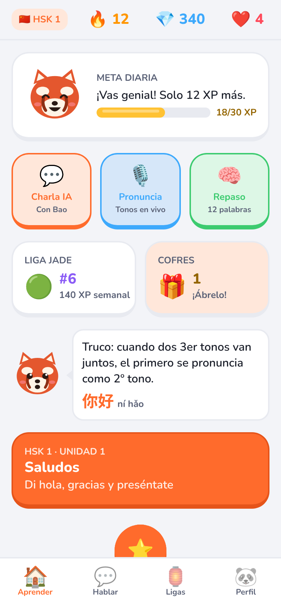 | 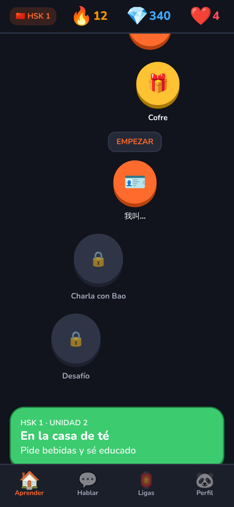 | 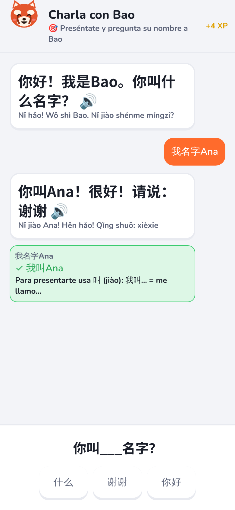 |

| Opción múltiple | Fallo con corrección | Ordenar la frase | Escritura de trazos |
| --- | --- | --- | --- |
| 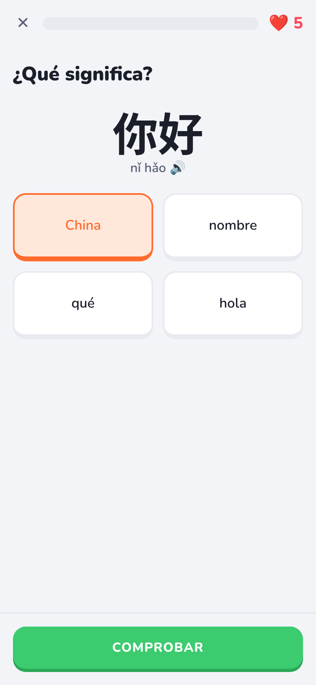 | 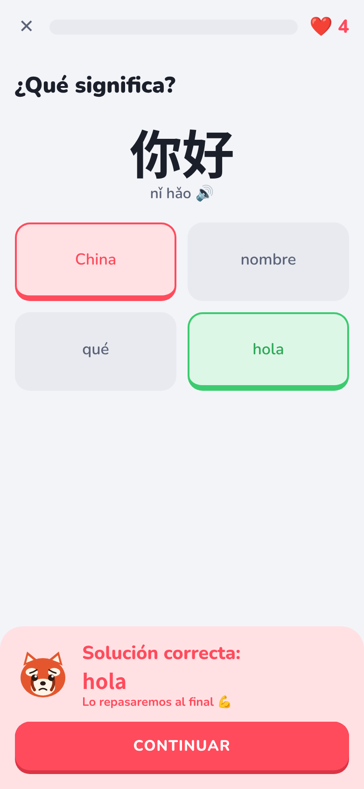 | 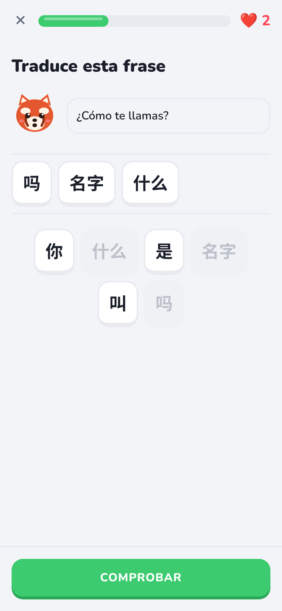 | 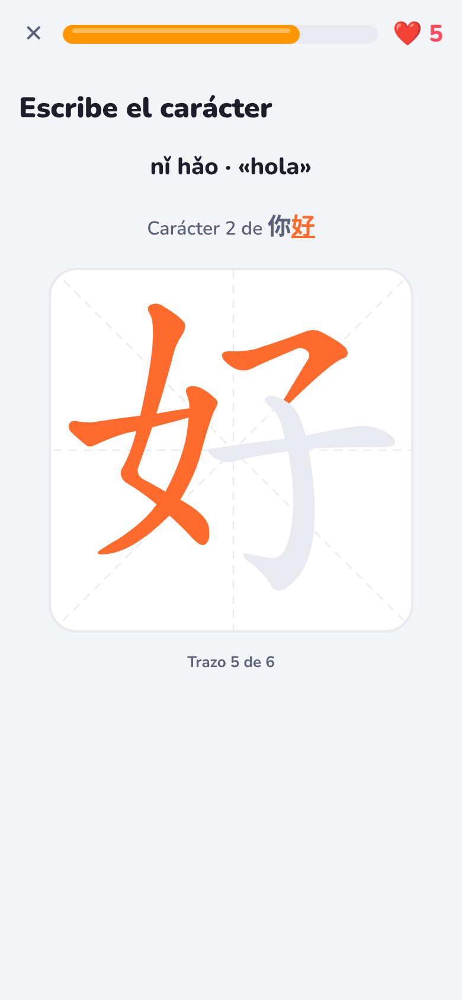 |

| Emparejar (oscuro) | Lección completada | Sin vidas | Hablar |
| --- | --- | --- | --- |
| 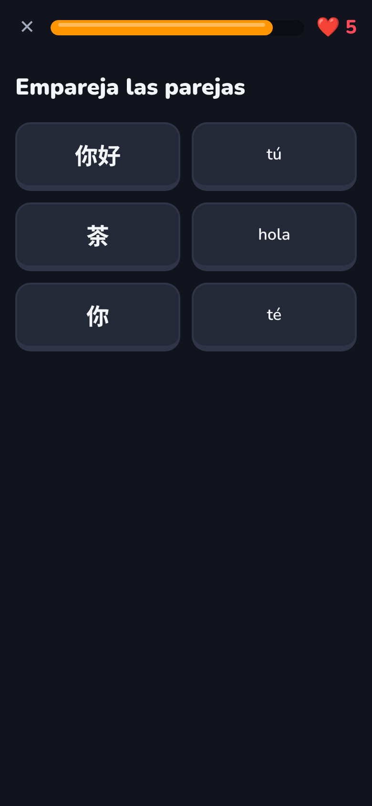 | 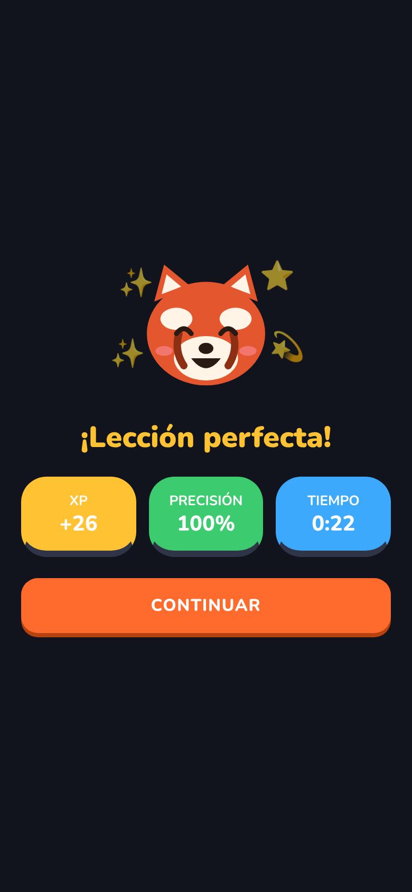 | 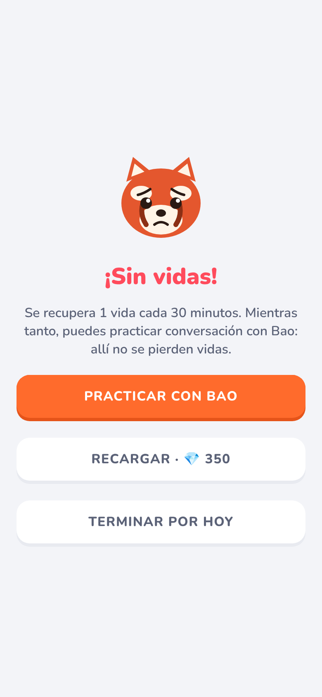 | 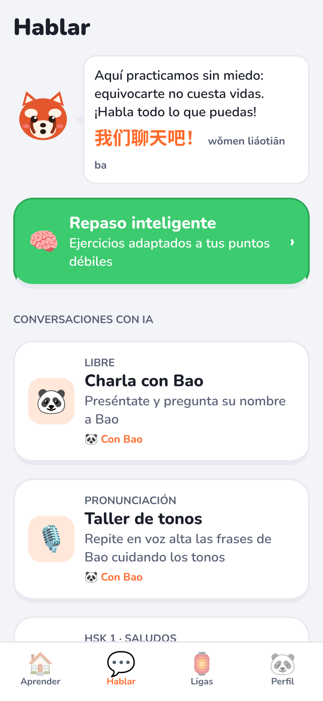 |

| Ligas | Perfil | Ajustes (tema oscuro) |
| --- | --- | --- |
| 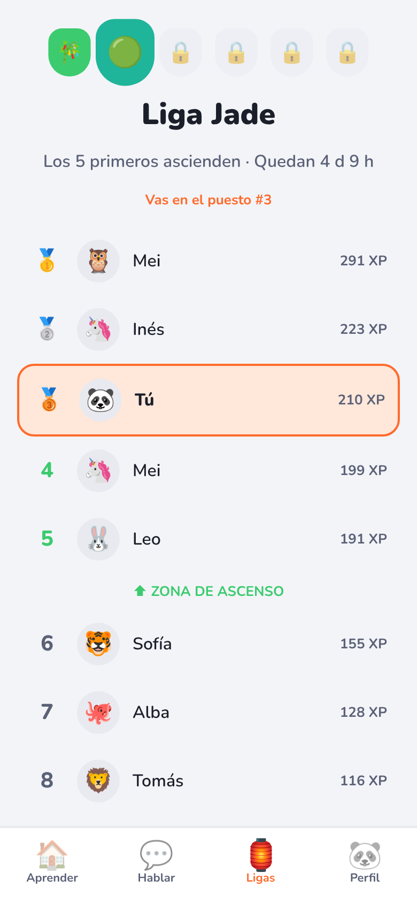 | 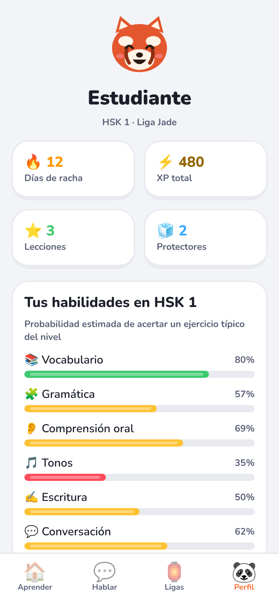 | 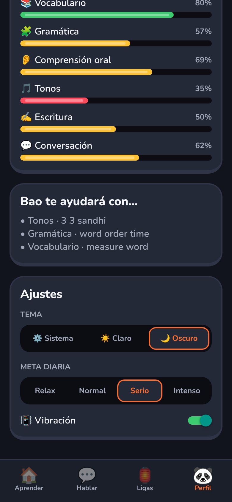 |

> Capturas reales de la app renderizada (Expo web, 390×844), recorrida automáticamente con Playwright (respuestas, fallos y trazos dibujados con el ratón). El chat usa respuestas simuladas del backend.

## Stack

| Capa | Elección | Por qué |
| --- | --- | --- |
| App | **React Native + Expo SDK 57** (TypeScript, Nueva Arquitectura) | Un código para iOS/Android, OTA updates, mismo lenguaje que el backend |
| Navegación | **Expo Router** (rutas por archivos) | Deep links (`pandago://chat`) y modales gratis |
| Animación | **Reanimated 4** (hilo UI) + **react-native-svg** | Microinteracciones a 60/120 fps; Bao es vectorial y se anima por estado |
| Háptica | `expo-haptics` | Vocabulario único: `tap`, `press`, `correct`, `wrong`, `levelUp` |
| Estado | **Zustand** + `persist` (AsyncStorage) | Progreso offline-first; se sincroniza con el servidor en segundo plano |
| Voz | `expo-audio` (grabación) + `expo-speech` (TTS zh-CN) | Grabar → backend de evaluación de pronunciación |
| Backend | **Node + Hono** + **Claude API** (`@anthropic-ai/sdk`, salida estructurada con Zod) | La API key nunca está en el móvil; validación del contrato en ambos lados |

## Estructura de carpetas

```
pandago/
├── app/                          # Rutas (Expo Router) — solo "pegamento", sin lógica
│   ├── _layout.tsx               # Fuentes, ThemeProvider, gestos, Stack raíz
│   ├── (tabs)/                   # Barra inferior: Aprender · Hablar · Ligas · Perfil
│   │   ├── _layout.tsx
│   │   ├── index.tsx             # → features/home/HomeScreen
│   │   ├── practice.tsx          # → features/practice/PracticeScreen
│   │   ├── leagues.tsx           # → features/leagues/LeaguesScreen
│   │   └── profile.tsx           # → features/profile/ProfileScreen
│   ├── chat.tsx                  # Conversación IA (modal a pantalla completa)
│   ├── lesson/[id].tsx           # Lección de ejercicios
│   └── review.tsx                # Repaso SRS
│
├── src/
│   ├── theme/                    # Design system
│   │   ├── tokens.ts             # Colores semánticos claro/oscuro, radios, tipografía, motion
│   │   └── ThemeProvider.tsx     # useTheme() + preferencia sistema/claro/oscuro
│   ├── components/
│   │   ├── ui/                   # Primitivas: Button3D, Card, PressableScale, ProgressBar, StatPill, Segmented
│   │   └── mascot/               # Bao: BaoFace (SVG), Bao (animaciones por mood), BaoBubble
│   ├── features/                 # Un directorio por dominio (vertical slices)
│   │   ├── home/                 # HomeScreen + TopStatusBar, DailyGoalCard, QuickActions,
│   │   │                         #   LeagueChestRow, LearningPath, PathNode
│   │   ├── chat/
│   │   │   ├── ChatScreen.tsx
│   │   │   ├── components/       # MessageBubble, TaskInput (texto / hueco / micrófono)
│   │   │   └── engine/           # ⚙️ Lógica pura, testeable sin UI
│   │   │       ├── contract.ts   # Esquemas Zod compartidos app ⇄ servidor
│   │   │       ├── orchestrator.ts  # Máquina de estados del chat (reducer)
│   │   │       ├── tones.ts      # Sandhi tonal, tonos desde pinyin, puntuación por sílaba
│   │   │       └── aiClient.ts   # HTTP al backend (tutor + evaluación de voz)
│   │   ├── lesson/               # 📝 Lecciones
│   │   │   ├── LessonScreen.tsx  # Orquesta ejercicios, vidas, XP y fin de lección
│   │   │   ├── components/       # MultipleChoice, SentenceOrder, MatchPairs, StrokeWriting,
│   │   │   │                     #   ChoiceTile, FeedbackBanner, LessonHeader, LessonEnd
│   │   │   └── engine/           # ⚙️ Lógica pura
│   │   │       ├── exerciseFactory.ts  # Genera los 4 tipos de ejercicio + corrección (grade)
│   │   │       ├── lessonReducer.ts    # Máquina de estados: responder → feedback → … → fin
│   │   │       ├── strokeMatcher.ts    # Reconocimiento de trazos (forma, sentido y orden)
│   │   │       └── random.ts           # PRNG con semilla (lecciones reproducibles)
│   │   ├── practice/             # Pestaña Hablar: escenarios de IA + repaso inteligente
│   │   ├── leagues/              # Liga semanal: clasificación, zonas de ascenso/descenso
│   │   ├── profile/              # Estadísticas, habilidades por dimensión, ajustes
│   │   └── learning/adaptive/    # 🧠 Motor adaptativo HSK
│   │       ├── learnerModel.ts   # Elo por dimensión + dominio por ítem + etiquetas de error
│   │       ├── srs.ts            # Repetición espaciada (curva de olvido tipo FSRS)
│   │       └── levelEngine.ts    # Selección de ejercicios, dificultad en sesión, promoción HSK
│   ├── store/                    # useProgressStore (racha, vidas, XP, ligas, cofres) · useLearnerStore · useSettingsStore
│   ├── data/hsk/                 # Tipos de contenido + muestra HSK 1 (20 palabras, 5 frases)
│   ├── data/strokes/             # Orden de trazos (Make Me a Hanzi) de los caracteres de la muestra
│   └── lib/                      # haptics (respeta el ajuste), auth, navigation
│
├── tests/                        # node:test — motor de lecciones, trazos, tonos, chat, ligas
│
├── server/                       # Backend del tutor IA
│   └── src/
│       ├── index.ts              # POST /v1/tutor/turn (Hono)
│       ├── tutor.ts              # Llamada a Claude con structured outputs + reintento de nivel
│       ├── promptBuilder.ts      # System prompt estable (cacheado) + turno volátil
│       ├── levelGuard.ts         # Verificación determinista de vocabulario fuera de nivel
│       └── vocab.ts
│
└── docs/
    ├── AI_ENGINE.md              # Lógica del motor de IA conversacional y de adaptación HSK
    └── screenshots/
```

**Regla de dependencias:** `app/` → `features/` → `components/`, `store/`, `theme/`. Los `engine/` y `adaptive/` no importan React ni React Native, así que se prueban con Node y el servidor puede reutilizar el contrato.

## Diseño visual (resumen)

- **Paleta "panda rojo"**: naranja Bao `#FF6B2C` (acción principal), verde bambú (acierto), cereza (error/vidas), oro (XP/cofres), violeta (ligas). Todos los componentes usan **roles semánticos** (`c.primary`, `c.successSoft`…) que cambian entre claro y oscuro; ningún componente usa un hex directo.
- **Profundidad táctil**: tarjetas y botones con *labio* inferior de 4 px; al pulsar, la cara baja y tapa el labio (`Button3D`), y todo lo pulsable encoge con resorte + háptica (`PressableScale`).
- **Tipografía**: Nunito (redonda, amable) para el latín y Noto Sans SC para los hanzi.
- **Bao** reacciona a todo: respira en reposo, salta con destellos al acertar, gira al completar, se estremece y anima al fallar, inclina la cabeza mientras la IA "piensa".
- **Camino serpenteante** (onda senoidal) con nodos completados ⭐, nodo actual flotando con "EMPEZAR", cofres que se agitan y nodos bloqueados 🔒.

## Lecciones (los 4 tipos de ejercicio)

Cada nodo del camino genera una lección de ~11 ejercicios con una progresión pedagógica: **reconocer** (hanzi → significado) → **recordar** (significado → hanzi) → **oír** (audio → hanzi, con botón 🐢 lento) → **producir** (ordenar la frase, escribir el carácter) → **consolidar** (emparejar).

- **Opción múltiple**: distractores de la misma longitud para que no se adivine por la forma; el audio se reproduce solo.
- **Ordenar la frase**: las fichas viajan entre el banco y la línea de respuesta con transiciones de layout; incluye distractores y da crédito parcial por posiciones correctas.
- **Emparejar**: se autocorrige pareja a pareja (verde/salto o rojo/temblor).
- **Escritura de trazos**: se dibuja con el dedo sobre una cuadrícula 米字格. Cada trazo se compara con la línea central real del trazo (datos de [Make Me a Hanzi](https://github.com/skishore/makemeahanzi)) y se valida **forma, sentido y orden**; tras 2 fallos el trazo esperado parpadea como pista.

Los fallos cuestan una vida y se **repiten al final de la lección** (una vez). Al terminar: XP (10 + aciertos a la primera + bonus por combo y por lección perfecta), precisión y tiempo, y se desbloquea el siguiente nodo. Sin vidas: recargar con gemas o ir a **practicar con Bao**, que no gasta vidas. El **repaso** (`/review`) lo planifica el motor adaptativo y tampoco cuesta vidas.

## Gamificación

Implementada en `src/store/useProgressStore.ts`:

- **Racha diaria** con *protectores de racha* que cubren días perdidos automáticamente.
- **Vidas** (5): se pierden en lecciones, se regeneran 1 cada 30 min. En el chat con IA **no se pierden vidas**, para que hablar sea seguro.
- **XP** con meta diaria configurable (Relax 10 · Normal 20 · Serio 30 · Intenso 50).
- **Ligas semanales** (Bambú → Jade → Seda → Linterna → Dragón → Emperador): grupos de 20, los 5 primeros ascienden y los 5 últimos descienden. Hoy los rivales se simulan de forma determinista por semana; en producción la clasificación viene del servidor.
- **Cofres** con recompensa variable (refuerzo intermitente) y un mínimo garantizado.

## Cómo probarla

**Sin instalar nada:** abre **https://alvj95.github.io/pandago/** (se vuelve a publicar sola en cada push a `main`).

**En tu ordenador** (necesitas [Node.js](https://nodejs.org) 20 o superior):

```bash
git clone https://github.com/Alvj95/pandago.git
cd pandago
npm install
```

**En el navegador (lo más rápido):**

```bash
npm run web               # abre http://localhost:8081 — usa la vista móvil de DevTools (F12)
```

**En tu móvil con Expo Go:** instala *Expo Go* (Play Store / App Store), y en el ordenador:

```bash
npx expo start            # escanea el QR (Android: desde Expo Go; iPhone: con la cámara)
npx expo start --tunnel   # si el móvil no está en la misma Wi-Fi
```

**En un emulador:** `npm run android` (Android Studio) o `npm run ios` (Xcode, solo macOS).

Todo funciona sin servidor (lecciones, escritura, ligas, perfil, tema) **excepto el chat con Bao**, que necesita el backend:

```bash
cd server && npm install
ANTHROPIC_API_KEY=tu_clave npm run dev   # http://localhost:8787
```

Desde un móvil, `localhost` es el propio móvil: pon la IP de tu ordenador en `app.json` → `expo.extra.apiUrl` (p. ej. `http://192.168.1.50:8787`).

Comprobaciones: `npm run typecheck` · `npm test` (20 pruebas).


## Publicación web (GitHub Pages)

`.github/workflows/deploy.yml` comprueba tipos y pruebas, exporta la web con la subruta del repositorio (`EXPO_BASE_URL`) y la publica en GitHub Pages en cada push a `main`. Hay que activarlo una vez en **Settings → Pages → Source: GitHub Actions**. En la web el chat con Bao necesita un backend público: define `EXPO_PUBLIC_API_URL` en el workflow cuando lo tengas desplegado.

## Qué falta para producción

- Servicio de voz `/v1/speech/assess`: ASR de mandarín + alineamiento forzado + clasificador de tonos por F0 (ver `docs/AI_ENGINE.md`).
- Autenticación real, sincronización del progreso con el servidor, ligas reales y el corpus HSK 1-6 completo (vocabulario, frases y datos de trazos).
- Efectos de sonido (acierto/fallo/cofre) y animación de Bao en **Rive** (state machine con los mismos estados que `BaoMood`) para sustituir al SVG.
- Nodos de tipo "Desafío" (jefe de unidad) y apertura animada de cofres.

## Licencias de datos

Los datos de orden de trazos (`src/data/strokes/`) provienen de Make Me a Hanzi / `hanzi-writer-data` y se distribuyen bajo la Arphic Public License (incluida en `src/data/strokes/ARPHICPL.TXT`).
